<div align="center">


# StudyPulse

**Your own study app: pick a subject, set a goal, start the timer, and watch your progress grow.**

[](https://studypulse-tracker-app.web.app)
&nbsp;
[](#who-can-use-it)
&nbsp;
[](#install-it)

[How it works](#how-it-works-in-one-picture) · [Step by step](#step-by-step) · [Calendar](#the-calendar) · [Progress](#your-progress) · [Admin](#for-the-admin) · [Install](#install-it) · [Developers](#for-developers)

</div>

> Pictures use example data.

---

## How it works in one picture

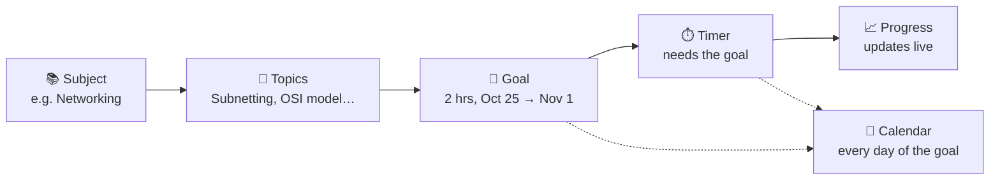

| Step | Where in the app | What you do |
|---|---|---|
| 1. Subject | **Study → Subjects → Add Subject** (or **+ New subject…** in any Subject box) | Name what you study, pick a color |
| 2. Topics | Open the subject → **Topics** (or type one on the Timer) | Add as many topics as you like |
| 3. Goal | Subject page → **Set a goal**, or the Timer's **Set goal** | Hours, a start date and an end date (1 week, 1–3 months…) |
| 4. Timer | **Start studying** / **Study** next to a topic | Press play. The timer only starts once the subject has a goal |
| 5. Progress | **Today** (first thing you see), **Progress** | Minutes go up while the timer runs |

---

## Step by step

### 1 · Open the app: your goals come first

The **Today** page opens with **Your goals**. No goal yet? It shows a 4-step **Start here** guide instead.

<p align="center">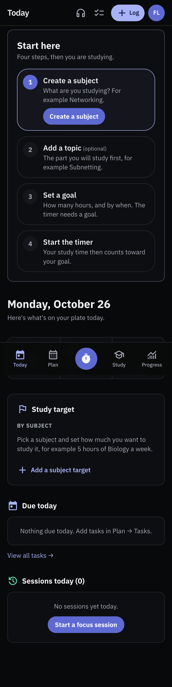</p>

### 2 · The timer needs a goal

Pick a subject and a topic (choose one, or type a new one: *"What are you studying?"*). Without a goal for that subject, the play button stays grey and a **Set goal** button appears.

<p align="center">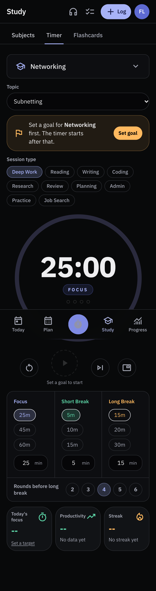</p>

### 3 · While you study, everything moves live

- **Today** shows *Studying now: Subnetting · 3 min so far* and the goal bar fills up.
- The **Start studying** button turns into **Pause 21:50** (and **Resume** when paused), so nobody starts a second timer by mistake.
- The small floating timer shows the subject **and** the topic on every page.
- The session counts as soon as it runs, and is saved for good when the focus ends or you stop it.

<p align="center">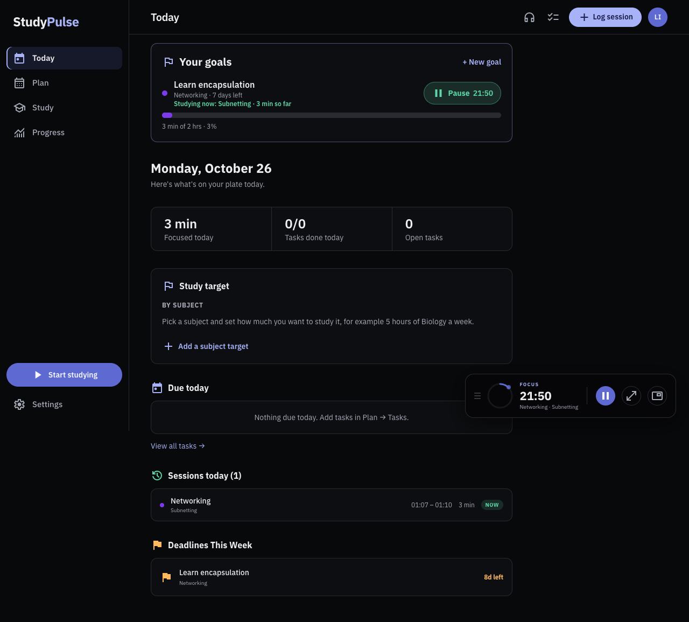</p>

### 4 · Study targets per subject (optional)

**Today → Study target → Add a subject target**: e.g. *Networking, 2 hrs a day, 10 hrs a week*. Each target belongs to a subject and has its own **Start studying** button. With 2 or more subjects, the total shows too.

<p align="center">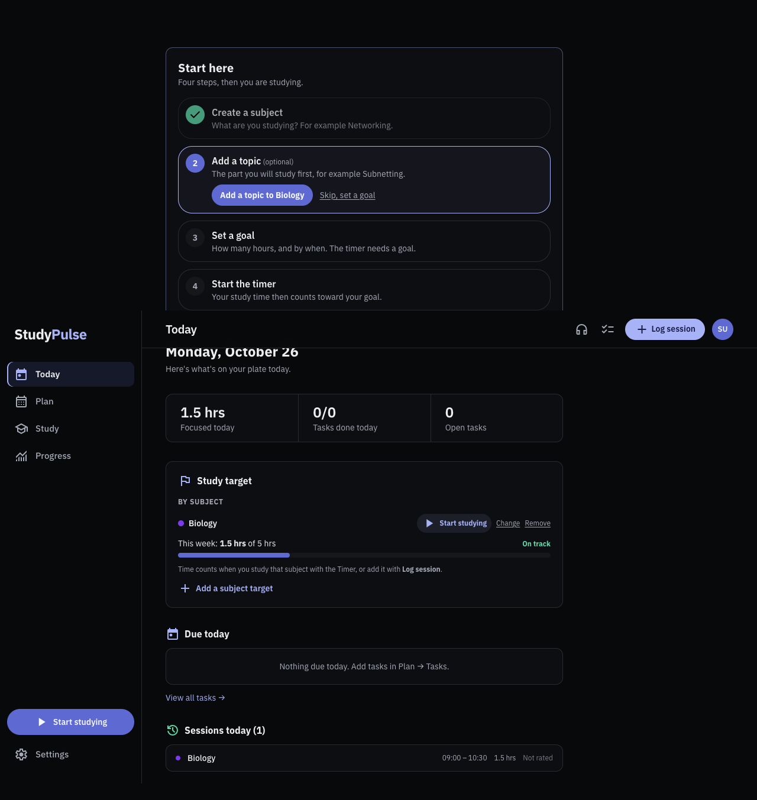</p>

---

## The calendar

**Plan → Calendar** (Day, Week or Month). It fills itself from what you do:

| You do this… | …and the calendar shows |
|---|---|
| Set a goal from one date to another | 🚩 the goal on **every day** of that period (*Start:* … *Due:*) |
| Run the timer or **Log session** | ⏱️ the study session (the running one too, marked *studying now*) |
| **Plan study** (or click an empty hour) | 📝 a planned study block |
| Add an exam / a task with a due date | 📌 the exam / the task |
| Add classes in **Timetable** | 🏫 your classes every week |

<p align="center">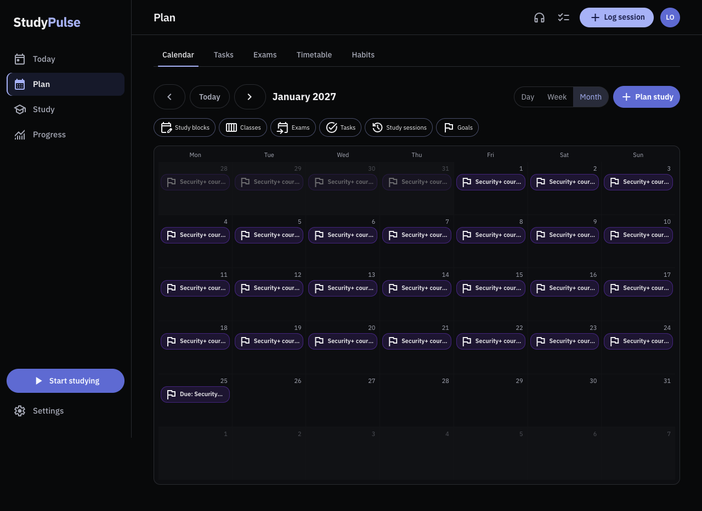</p>

<details><summary>Week view</summary>
<p align="center">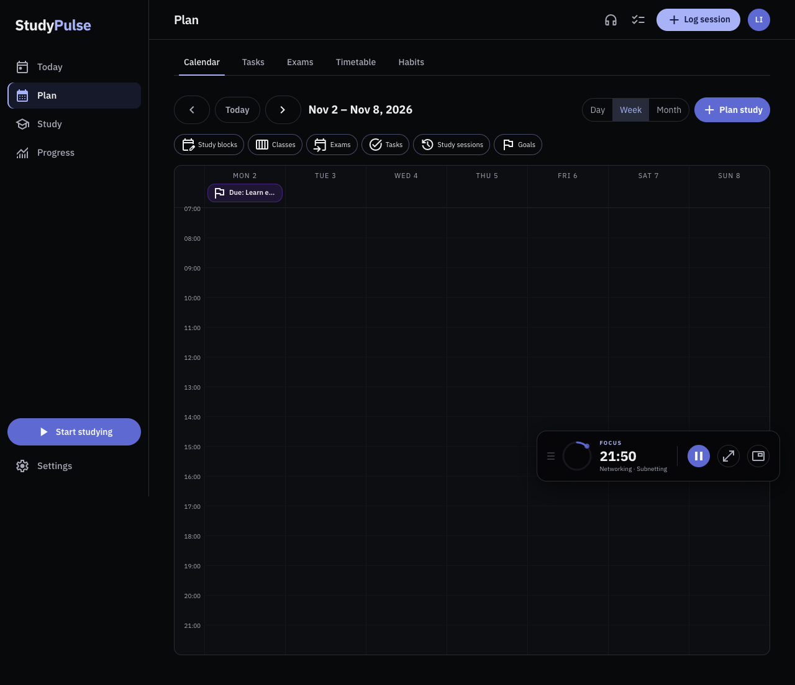</p>
</details>

Want it in Google or Apple Calendar too? **Settings → Calendar link** gives a private link that updates by itself.

---

## Your progress

**Progress → Overview**: what you do well, goals ahead, and a **GitHub-style year of squares**: one square per day, darker green = more study. Under it: days studied, current streak, longest streak, best day.

<p align="center">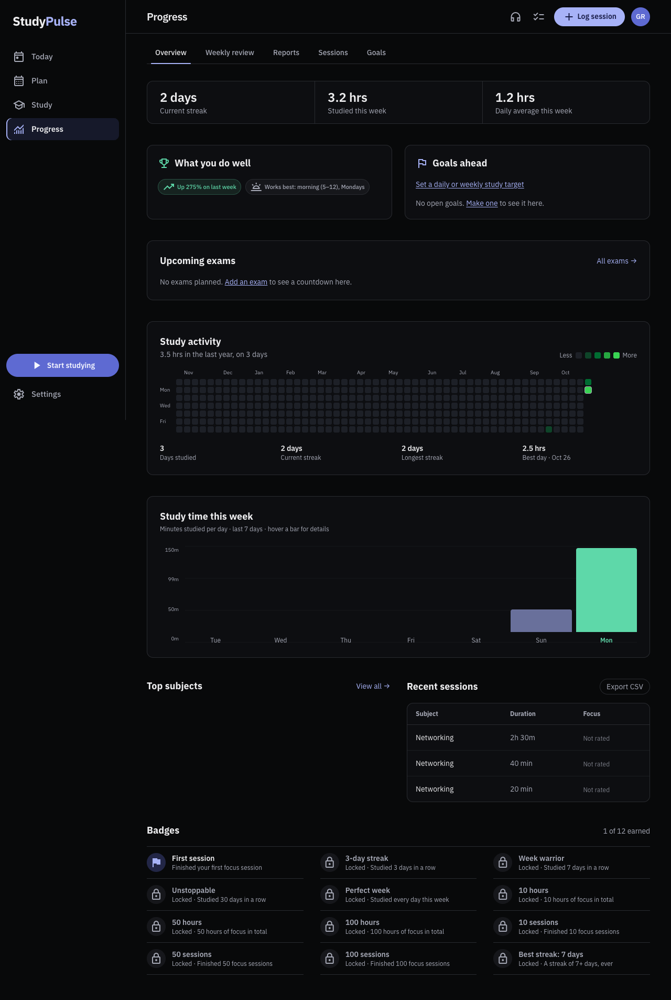</p>

Also on **Progress**: Weekly review, Reports, every Session (edit or delete any), and Goals.

---

## Add, change, delete anything

Everything you create (subjects, topics, goals, targets, sessions, tasks, exams, classes, study blocks, habits, flashcards) can be **edited** and **deleted**. Every edit form ends with a red **Delete this …** button.

---

## Who can use it

StudyPulse is **invite only**. The admin invites an email; that person gets an email with a **Join StudyPulse** button and signs up with **Google** or **email + username + password** (they confirm their email once). Next time they sign in with their **email or username**.

<p align="center">
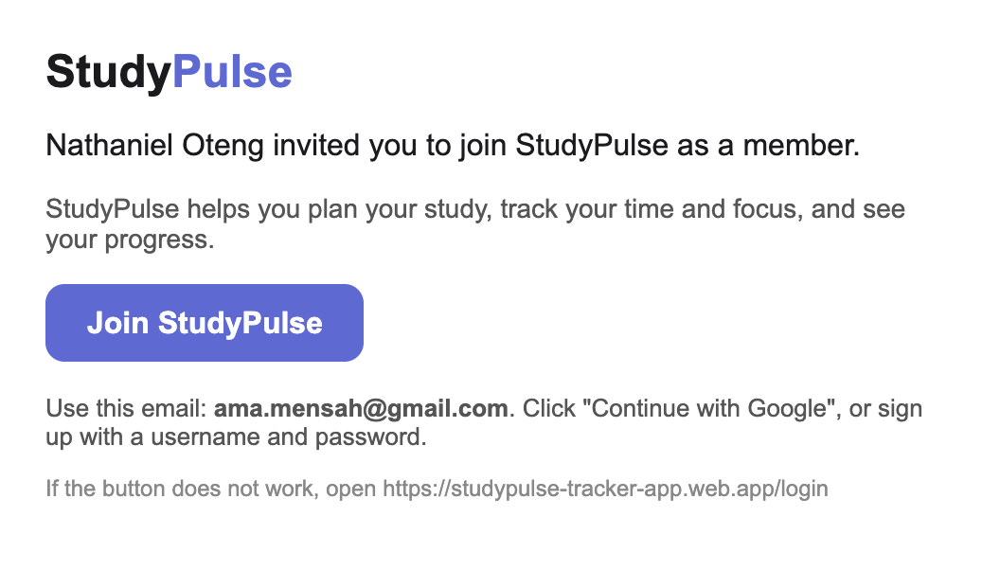
&nbsp;
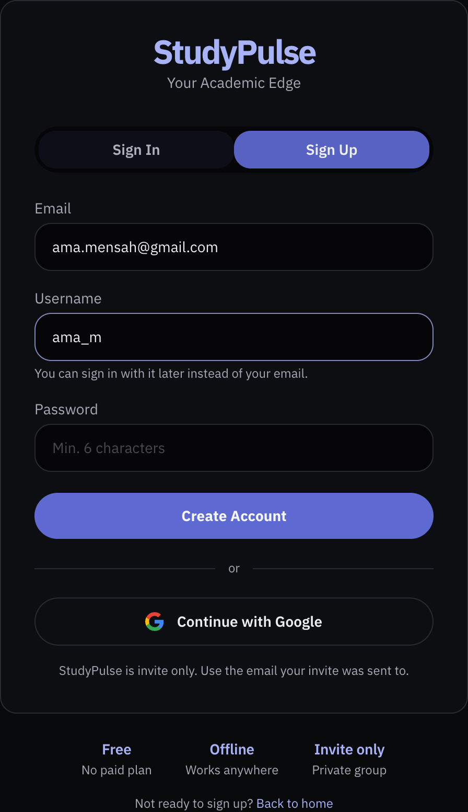
</p>

---

## For the admin

**Admin** (sidebar, or the round letters at the top right on a phone):

| Tab | What it shows / does |
|---|---|
| **Team** | People, hours in the last 7 days, who was active, average focus, a 14-day chart, *Needs a look*, a leaderboard. Tap a person for their details and their year of squares. |
| **People** | Invite as **Member** or **Admin** (the email goes out from your Gmail), change roles, remove people. You and the owner are locked. |

<p align="center">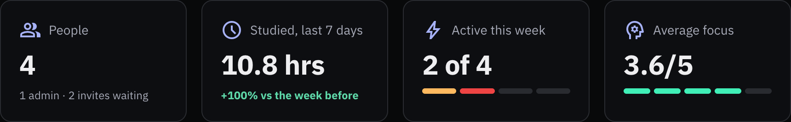</p>
<p align="center">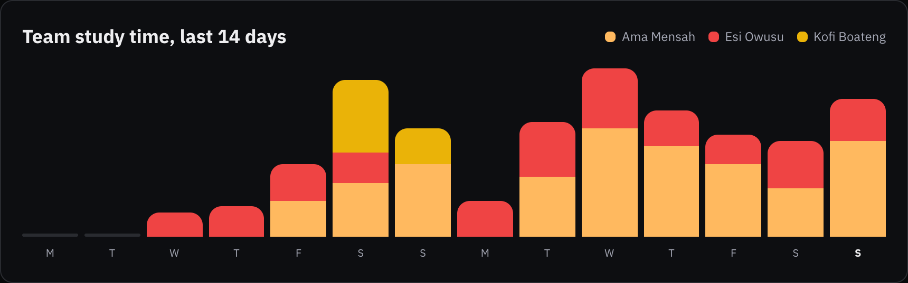</p>
<p align="center">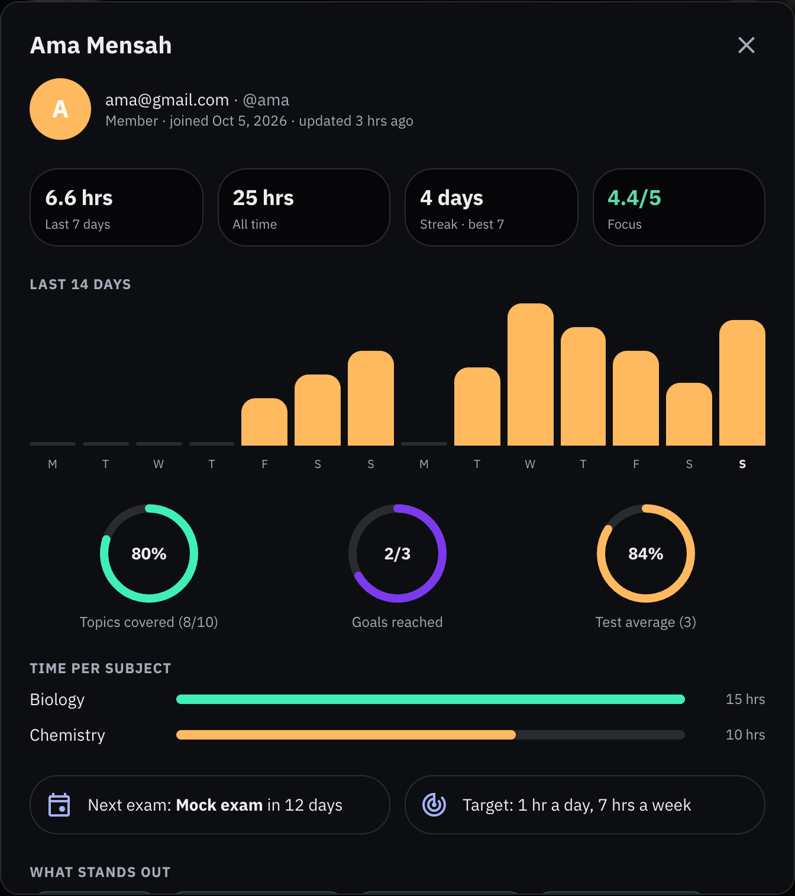 &nbsp; 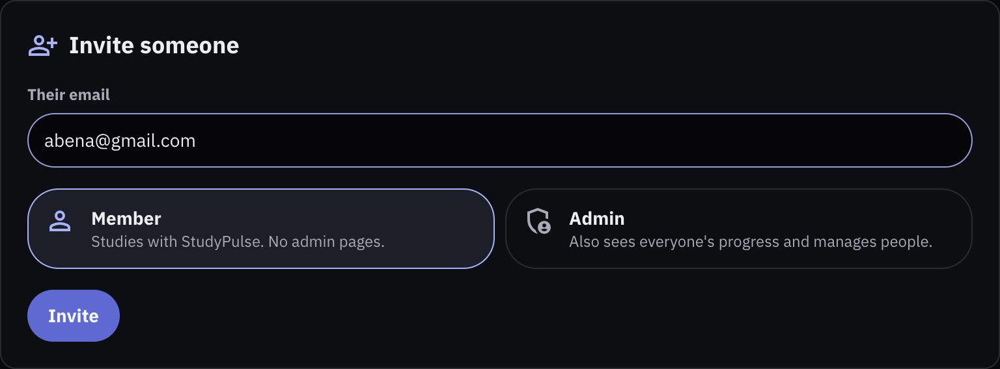</p>

Admins see **progress numbers only** (time, streaks, focus, goals, scores), never notes or flashcards.

---

## Install it

StudyPulse is a free web app that installs like a normal app: its own icon, its own window, and it works offline.

| Device | How |
|---|---|
| 💻 **Laptop — Chrome or Edge** | Open [studypulse-tracker-app.web.app](https://studypulse-tracker-app.web.app), sign in, click the **install icon** at the right of the address bar. |
| 💻 **Mac — Safari** | Open the site, then **File → Add to Dock**. |
| 📱 **iPhone / iPad** | Open the site in **Safari** → **Share** → **Add to Home Screen**. |
| 📱 **Android** | Open the site in Chrome → menu **⋮** → **Install app**. |

Reminders: **Settings → Reminders**.

---

## For developers

<details>
<summary><b>Set up and run locally</b></summary>

Requirements: Node.js 20+, npm, Firebase CLI (`npm i -g firebase-tools`) and Java (for the emulators).

```bash
git clone https://github.com/clevernat/study-pulse.git
cd study-pulse
npm install
npm --prefix functions install
```

Create `.env.local` with your Firebase web app config:

```env
NEXT_PUBLIC_FIREBASE_API_KEY=...
NEXT_PUBLIC_FIREBASE_AUTH_DOMAIN=...
NEXT_PUBLIC_FIREBASE_PROJECT_ID=...
NEXT_PUBLIC_FIREBASE_STORAGE_BUCKET=...
NEXT_PUBLIC_FIREBASE_MESSAGING_SENDER_ID=...
NEXT_PUBLIC_FIREBASE_APP_ID=...
```

```bash
npm run dev:local     # emulators + next dev on http://localhost:3000
npm run seed:local    # creates the test login (see LOCAL_CREDENTIALS.md)
```

</details>

<details>
<summary><b>Tests</b></summary>

| Command | What it runs |
|---|---|
| `npm test` | Unit tests (Jest) |
| `npm run test:rules` | Firestore security rules on the emulator |
| `npm run test:functions` | Server code on the emulator |
| `npm run test:e2e` | Builds the app and runs Playwright on the Firebase emulators (laptop + phone sizes) |
| `npm run test:all` | All of the above |
| `npm run lint` / `npm run build` | Lint / production build |
| `npm run docs:screenshots` | Re-makes the README pictures with sample data (emulators only) |

Results and screenshots: [`TEST_REPORT.md`](TEST_REPORT.md) and `docs/evidence/`.

</details>

<details>
<summary><b>Deploy (free Spark plan)</b></summary>

```bash
npm run build        # uses .env.local (never deploy the output of build:e2e)
firebase deploy --only firestore:rules,firestore:indexes,hosting
```

</details>

<details>
<summary><b>Server features (later)</b></summary>

The server parts run on a **free Cloudflare Worker** (`worker/`): a live, private `.ics` calendar link (`/cal/<secret>.ics`, for Google/Apple/Outlook) and reminder push every 5 minutes, also when the app is closed (sent through Firebase Cloud Messaging). The Worker reads Firestore over its REST API with the `studypulse-worker` service account (roles: Cloud Datastore User, Firebase Cloud Messaging API Admin); its key is the Worker secret `SERVICE_ACCOUNT`. Deploy it with `npm run worker:deploy`. The same logic (`functions/src/core.ts`) also exists as Cloud Functions in `functions/`, which need the paid Blaze plan and are not deployed; the e2e tests use them on the emulator. The app build turns the link on with `NEXT_PUBLIC_CALENDAR_FEED=1` and `NEXT_PUBLIC_CALENDAR_FEED_ORIGIN=https://studypulse-feed.studypulse-app.workers.dev`, and web push with `NEXT_PUBLIC_FIREBASE_VAPID_KEY` (all in `.env.local`).

</details>

<details>
<summary><b>Architecture</b></summary>

| Part | Technology |
|---|---|
| App | Next.js 14 (App Router, static export), TypeScript, Tailwind CSS, Zustand |
| Data | Firestore with offline cache; everything under `users/{uid}/…`, each member can only read and write their own data; admins read a progress summary only |
| Auth | Firebase Auth (Google, or email/username + password with a confirmed email); invite only |
| Offline / install | Web app manifest + service worker (`public/sw.js`) |
| Flashcards | ts-fsrs (scheduling), sql.js + fflate + fzstd (Anki import in a Web Worker), DOMPurify (safe card HTML) |
| Free-plan friendly | Screens read only what they need: cards due today, a few new cards per deck, a small summary per study day, count queries for totals |
| Tests | Jest, Playwright, @firebase/rules-unit-testing |

Collections: `subjects`, `sessions`, `tasks`, `goals`, `topics`, `exams`, `classes`, `studyBlocks`, `habits`, `decks`, `notes`, `cards`, `reviewLogs`, `reviewDays`, `reminders`, `devices`, `preferences`, `timerState`, `calendarFeed`; top level `calendarTokens`, `members`, `invites`, `usernames`, `progress` (invite-only access and the admin view, see `CLAUDE.md`).

</details>

---

## Credits and license

Scheduling uses [ts-fsrs](https://github.com/open-spaced-repetition/ts-fsrs) (MIT). Anki import uses [sql.js](https://github.com/sql-js/sql.js), [fflate](https://github.com/101arrowz/fflate) and [fzstd](https://github.com/101arrowz/fzstd) (MIT). No code was copied from other apps.

MIT © Oteng A. Nathaniel
