<div align="center">


# StudyPulse

**Flashcards, focus timer and study planner in one app — on your laptop and your phone.**

[](https://studypulse-tracker-app.web.app)
&nbsp;
[](#install-it)
&nbsp;
[](#install-it)

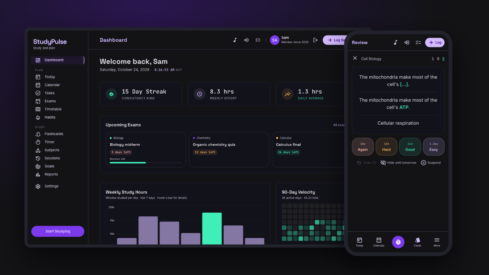

[Features](#what-you-can-do) · [Install](#install-it) · [Calendar](#put-your-plan-in-your-calendar) · [Development](#for-developers)

</div>

> The screenshots use sample data.

---

## What you can do

### 🧠 Remember more with flashcards

<table>
<tr>
<td width="62%">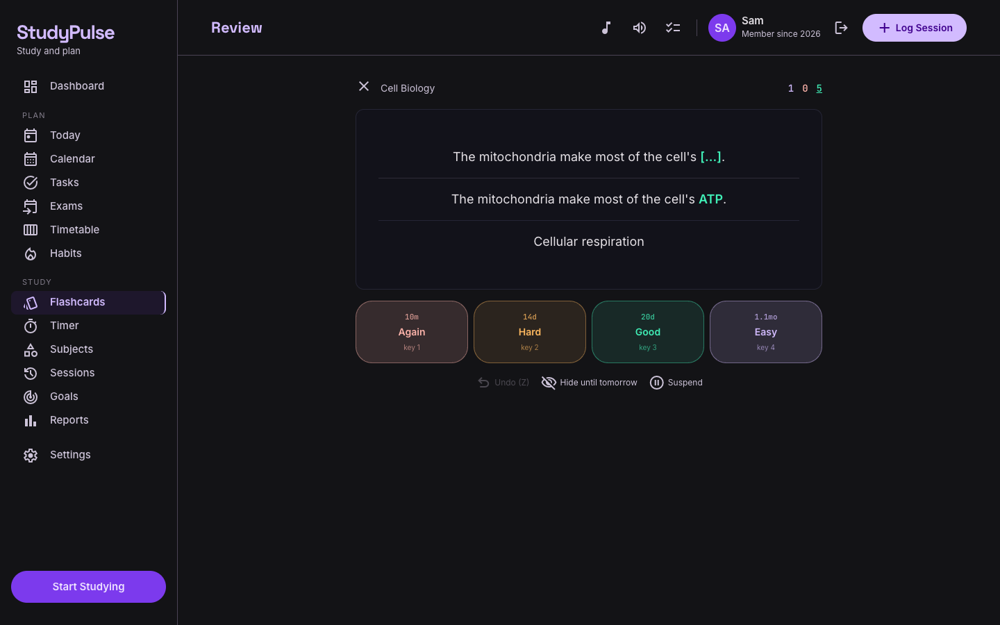</td>
<td width="38%">

- **Decks for each subject**: Basic, reverse and cloze cards (`{{c1::answer::hint}}`).
- **Spaced repetition (FSRS)** shows each card again just before you would forget it.
- **Again / Hard / Good / Easy** with the next interval on each button. Keys `Space`, `1`–`4`, `Z` to undo.
- **Import from Anki** (`.apkg`, old and new formats) or **CSV**.
- Review time counts as a study session.

</td>
</tr>
</table>

<table>
<tr>
<td width="50%">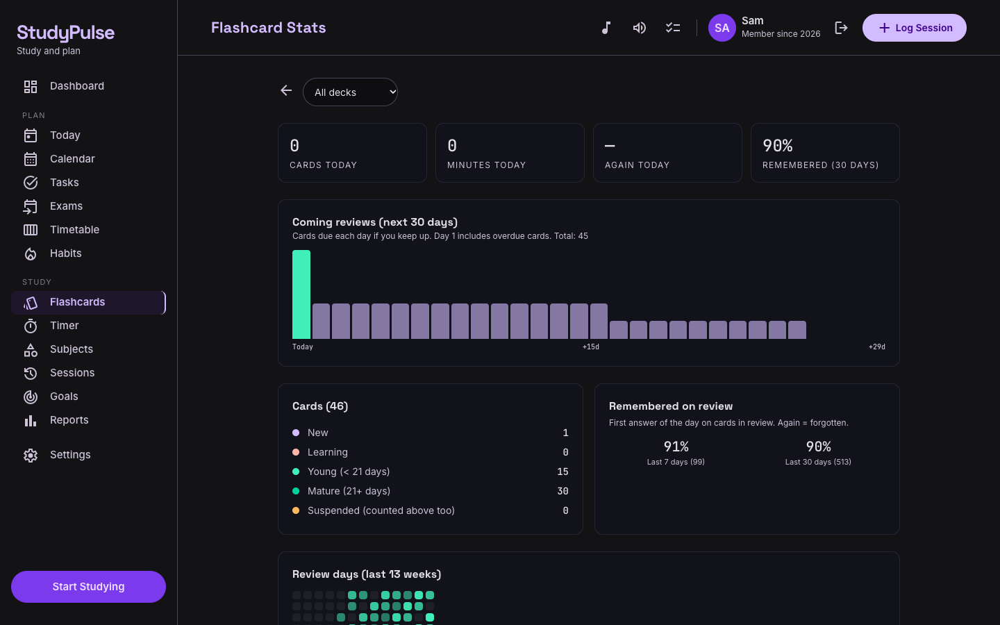<br/><sub><b>Stats:</b> today, 30-day forecast, how much you remember, review days.</sub></td>
<td width="50%">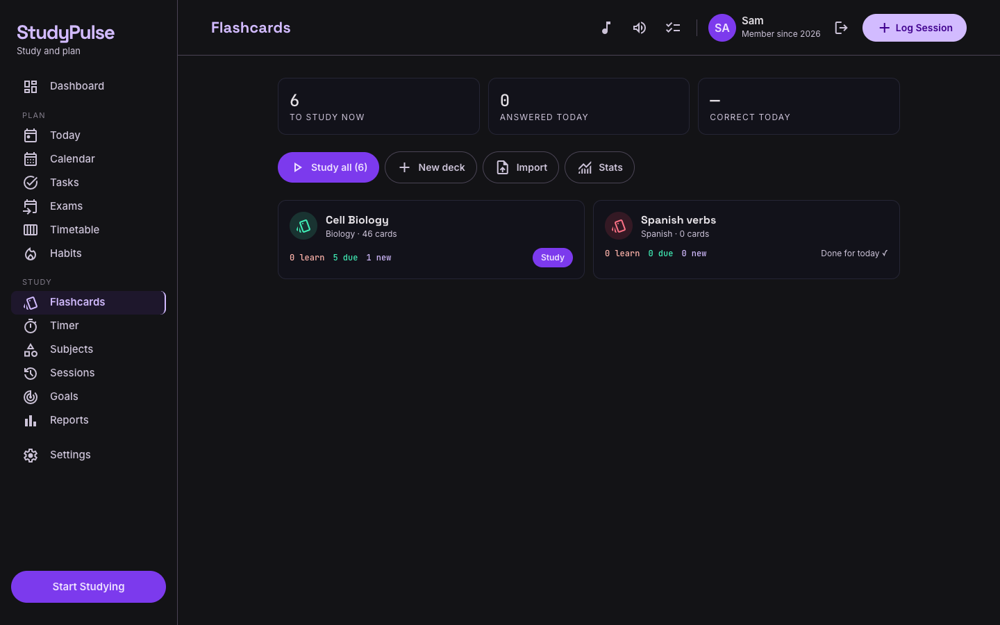<br/><sub><b>Decks:</b> what is due today in each deck.</sub></td>
</tr>
</table>

### 📅 Plan your week

<table>
<tr>
<td width="62%">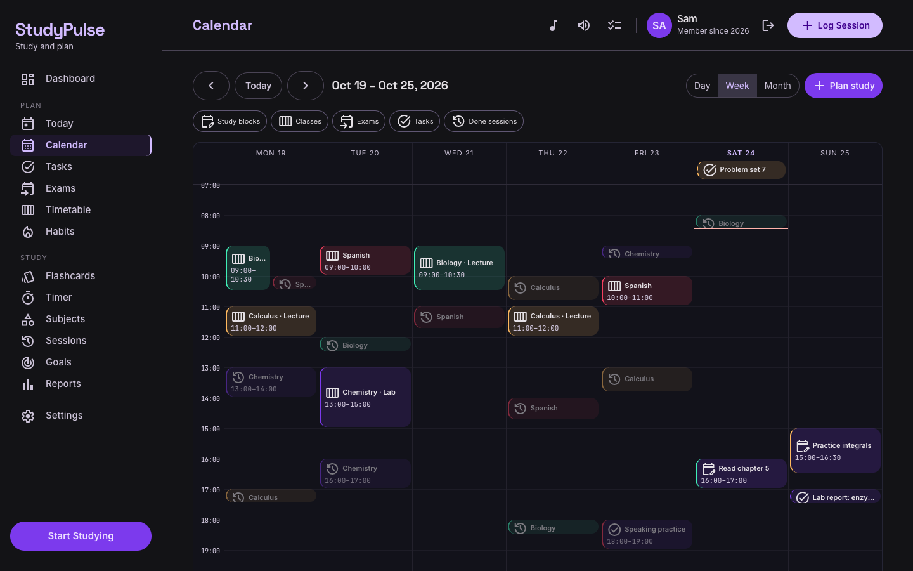</td>
<td width="38%">

- **Calendar** — day, week and month: classes, exams, homework, planned study and finished sessions.
- **Click an empty hour** to plan study time, then press **Start** to run the timer for it.
- **Timetable** with A/B weeks, term dates and holidays.
- **Exams** with a countdown, room and seat, and a warning when an exam clashes with a class.

</td>
</tr>
</table>

<table>
<tr>
<td width="50%">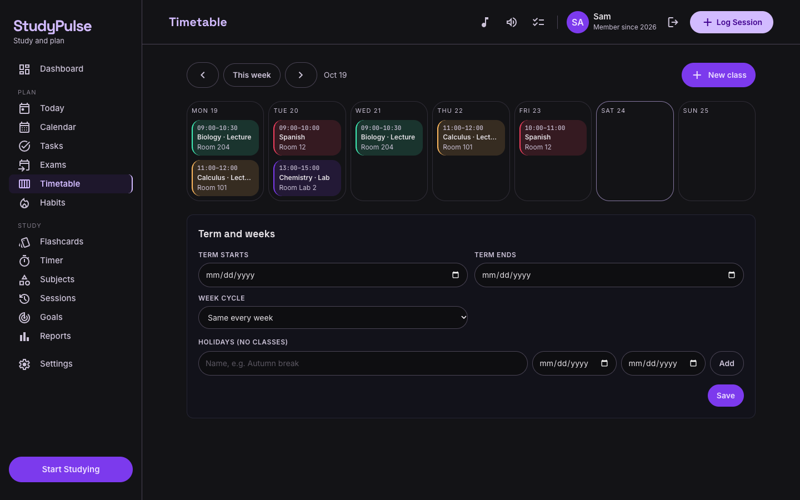<br/><sub><b>Timetable:</b> your classes, every week or A/B weeks.</sub></td>
<td width="50%">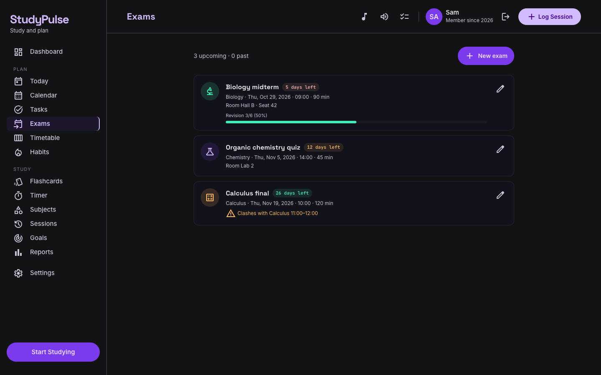<br/><sub><b>Exams:</b> days left and revision progress.</sub></td>
</tr>
<tr>
<td width="50%">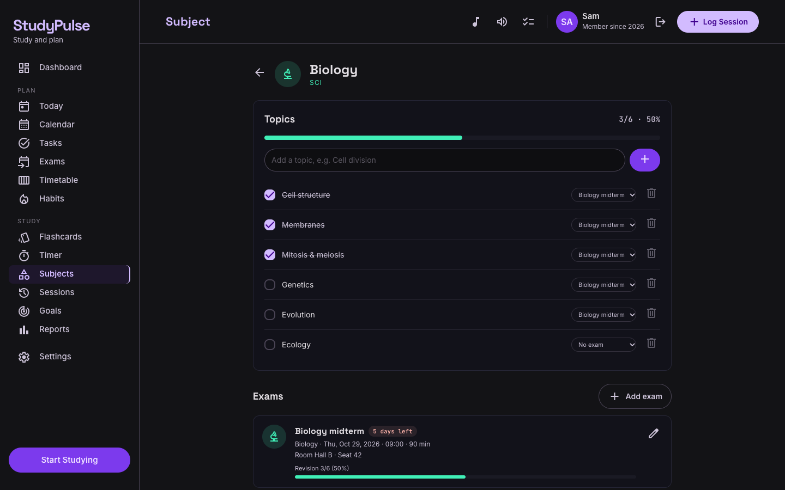<br/><sub><b>Subjects:</b> topics to check off, exams and decks in one place.</sub></td>
<td width="50%">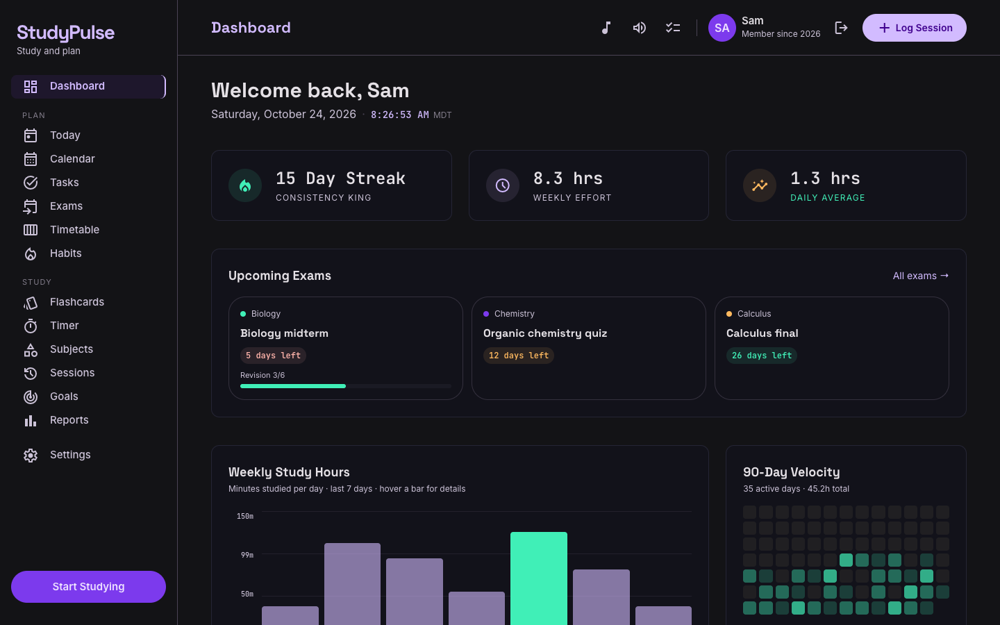<br/><sub><b>Dashboard:</b> streak, weekly hours, exam countdown, 90-day heat map, badges.</sub></td>
</tr>
</table>

### 📱 On your phone

<table>
<tr>
<td align="center" width="25%">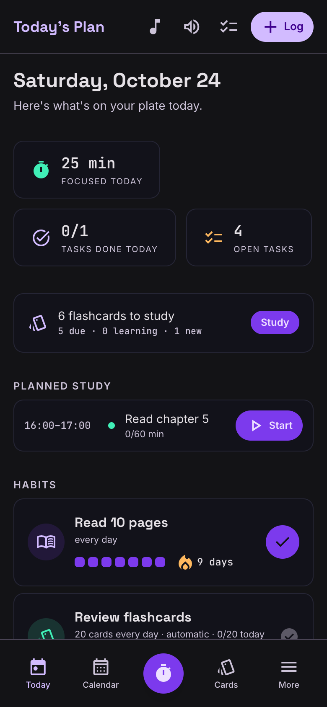<br/><sub><b>Today</b><br/>classes, cards, plan, habits</sub></td>
<td align="center" width="25%">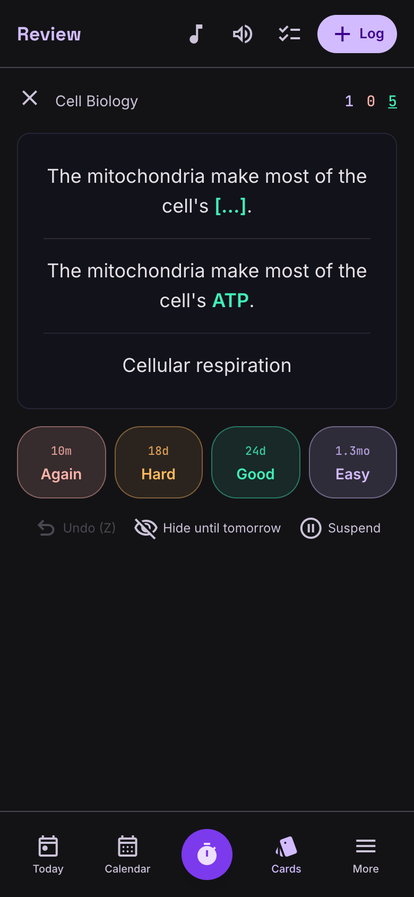<br/><sub><b>Review</b><br/>study cards anywhere</sub></td>
<td align="center" width="25%">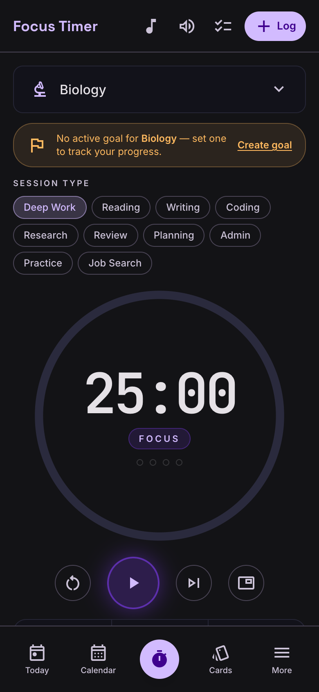<br/><sub><b>Focus timer</b><br/>Pomodoro + sounds</sub></td>
<td align="center" width="25%">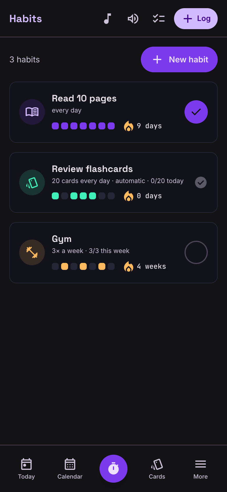<br/><sub><b>Habits</b><br/>streaks, daily or weekly</sub></td>
</tr>
<tr>
<td align="center">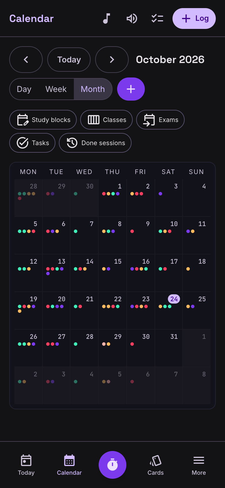<br/><sub><b>Month view</b></sub></td>
<td align="center">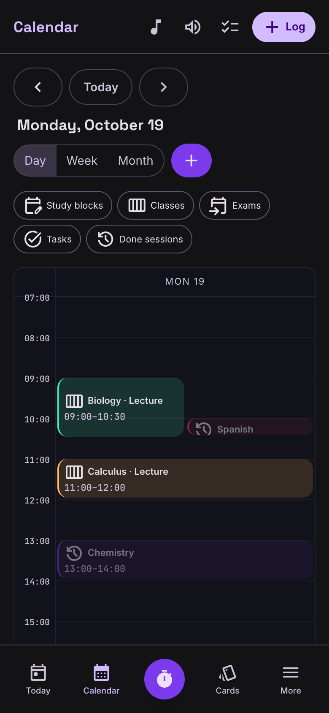<br/><sub><b>Day view</b></sub></td>
<td colspan="2" valign="top">

**Also in the app**

- ⏱️ Pomodoro timer with breaks, ambient sounds, a floating mini timer and picture-in-picture
- ✅ Tasks, homework and revision with due date, time and priority
- 🔥 Habits that can check themselves (minutes studied, cards reviewed)
- 🎯 Goals that fill up from your real study time
- 📊 Reports, streaks, badges, CSV/JSON export
- 🔔 Reminders and a daily summary (while the app is open)
- ☁️ Works offline, syncs when you are back online

</td>
</tr>
</table>

---

## Install it

StudyPulse is a free web app that installs like a normal app: its own icon, its own window, and it works offline.

| Device | How |
|---|---|
| 💻 **Laptop — Chrome or Edge** | Open [studypulse-tracker-app.web.app](https://studypulse-tracker-app.web.app), sign in, click the **install icon** at the right of the address bar (or **Settings → Install the app**). |
| 💻 **Mac — Safari** | Open the site, then **File → Add to Dock**. |
| 📱 **iPhone / iPad** | Open the site in **Safari** → **Share** button → **Add to Home Screen** → **Add**. Open StudyPulse from the new icon. |
| 📱 **Android** | Open the site in Chrome → menu **⋮** → **Install app**. |

Then turn on reminders in **Settings → Reminders**. After the first visit the app opens without internet; changes made offline are sent when you are online again.

---

## Put your plan in your calendar

**Settings → Calendar sync → Download calendar file (.ics)**, then import it:

| Calendar | Import |
|---|---|
| Google Calendar (computer) | ⚙ Settings → Import & export → Import |
| Apple Calendar (Mac) | File → Import |
| Outlook | Add calendar → Upload from file |

The file is a copy of your exams, homework, study blocks and classes. Download it again after changes.
A live link that updates by itself, and reminders when the app is closed, need a small server and will come later (see **Server features** under [For developers](#for-developers)).

---

## For developers

<details>
<summary><b>Set up and run locally</b></summary>

Requirements: Node.js 20+, npm, Firebase CLI (`npm i -g firebase-tools`) and Java (for the emulators).

```bash
git clone https://github.com/clevernat/study-pulse.git
cd study-pulse
npm install
npm --prefix functions install
```

Create `.env.local` with your Firebase web app config:

```env
NEXT_PUBLIC_FIREBASE_API_KEY=...
NEXT_PUBLIC_FIREBASE_AUTH_DOMAIN=...
NEXT_PUBLIC_FIREBASE_PROJECT_ID=...
NEXT_PUBLIC_FIREBASE_STORAGE_BUCKET=...
NEXT_PUBLIC_FIREBASE_MESSAGING_SENDER_ID=...
NEXT_PUBLIC_FIREBASE_APP_ID=...
```

```bash
npm run dev:local     # emulators + next dev on http://localhost:3000
npm run seed:local    # creates the test login (see LOCAL_CREDENTIALS.md)
```

</details>

<details>
<summary><b>Tests</b></summary>

| Command | What it runs |
|---|---|
| `npm test` | Unit tests (Jest) |
| `npm run test:rules` | Firestore security rules on the emulator |
| `npm run test:functions` | Server code on the emulator |
| `npm run test:e2e` | Builds the app and runs Playwright on the Firebase emulators (laptop + phone sizes) |
| `npm run test:all` | All of the above |
| `npm run lint` / `npm run build` | Lint / production build |
| `npm run docs:screenshots` | Re-makes the README pictures with sample data (emulators only) |

Results and screenshots: [`TEST_REPORT.md`](TEST_REPORT.md) and `docs/evidence/`.

</details>

<details>
<summary><b>Deploy (free Spark plan)</b></summary>

```bash
npm run build        # uses .env.local (never deploy the output of build:e2e)
firebase deploy --only firestore:rules,firestore:indexes,hosting
```

</details>

<details>
<summary><b>Server features (later)</b></summary>

`functions/` holds two small server programs: `calendarFeed` (a live, private `.ics` link for Google/Apple/Outlook) and `sendReminders` (web push every 5 minutes, also when the app is closed). Firebase only runs them on the paid Blaze plan, so they are not deployed. They can later run on a free Cloudflare Worker. Turn the live calendar link on in the app with `NEXT_PUBLIC_CALENDAR_FEED=1`, and web push with `NEXT_PUBLIC_FIREBASE_VAPID_KEY`.

</details>

<details>
<summary><b>Architecture</b></summary>

| Part | Technology |
|---|---|
| App | Next.js 14 (App Router, static export), TypeScript, Tailwind CSS, Zustand |
| Data | Firestore with offline cache; everything under `users/{uid}/…`, each user can only read and write their own data |
| Auth | Firebase Auth (email/password, Google) |
| Offline / install | Web app manifest + service worker (`public/sw.js`) |
| Flashcards | ts-fsrs (scheduling), sql.js + fflate + fzstd (Anki import in a Web Worker), DOMPurify (safe card HTML) |
| Free-plan friendly | Screens read only what they need: cards due today, a few new cards per deck, a small summary per study day, count queries for totals |
| Tests | Jest, Playwright, @firebase/rules-unit-testing |

Collections: `subjects`, `sessions`, `tasks`, `goals`, `topics`, `exams`, `classes`, `studyBlocks`, `habits`, `decks`, `notes`, `cards`, `reviewLogs`, `reviewDays`, `reminders`, `devices`, `preferences`, `timerState`, `calendarFeed`; top level `calendarTokens`.

</details>

---

## Credits and license

Scheduling uses [ts-fsrs](https://github.com/open-spaced-repetition/ts-fsrs) (MIT). Anki import uses [sql.js](https://github.com/sql-js/sql.js), [fflate](https://github.com/101arrowz/fflate) and [fzstd](https://github.com/101arrowz/fzstd) (MIT). No code was copied from other apps.

MIT © Oteng A. Nathaniel
